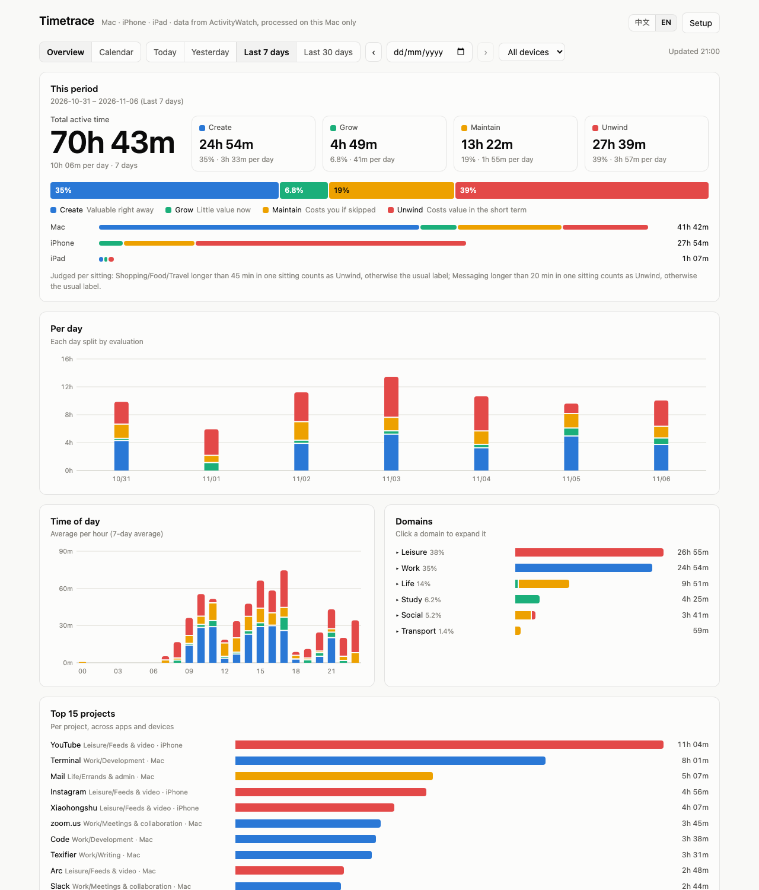
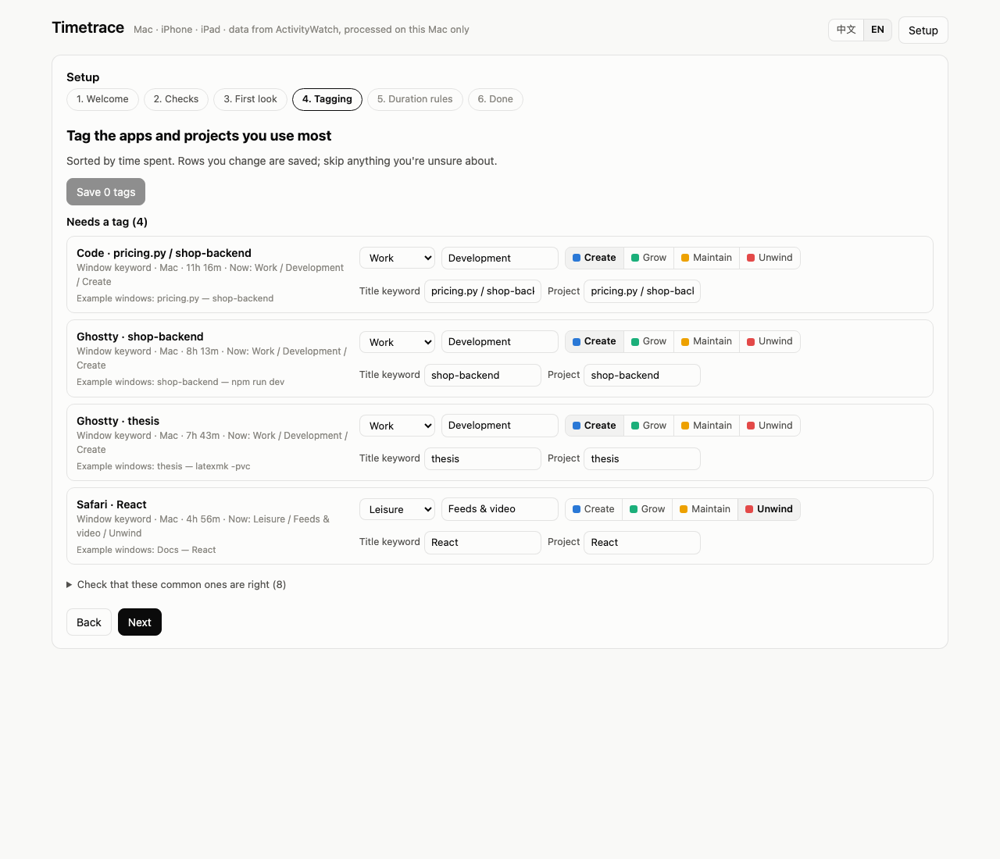
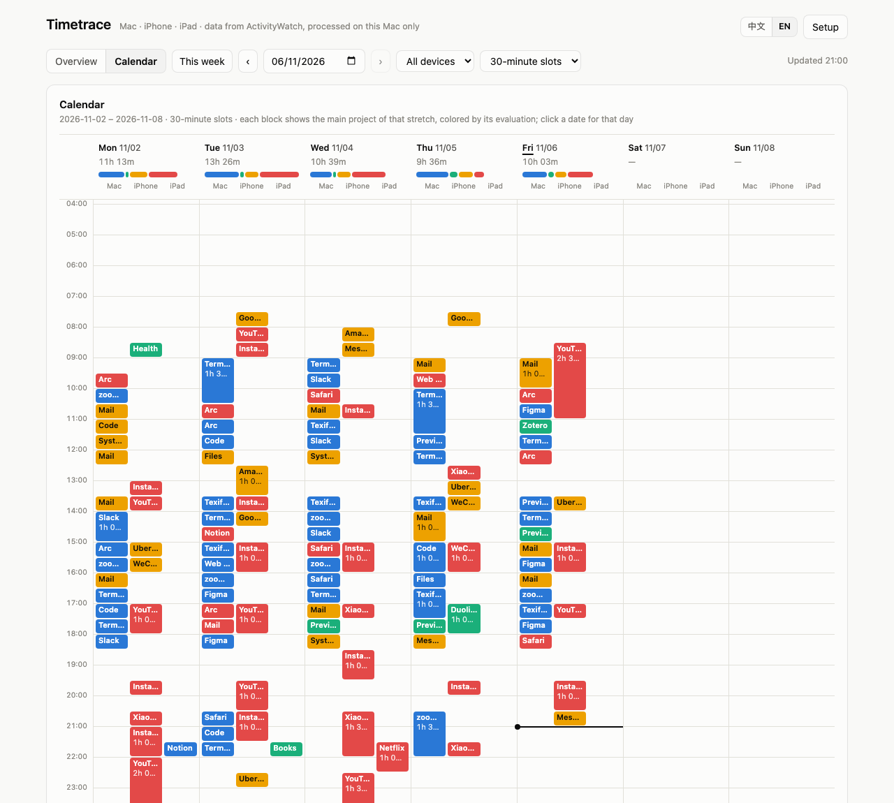

# timetrace

**Automatic time tracking across your Apple devices — Mac, iPhone and iPad — sorted by purpose and value, with a polished local dashboard and a CLI / MCP server your AI agents can use.**

[中文说明](README.zh-CN.md)



timetrace is a companion to [ActivityWatch](https://activitywatch.net). ActivityWatch records which window is active on your Mac; Apple's Screen Time syncs iPhone and iPad usage to the Mac; timetrace brings both together and answers two questions:

- **Where did the time go?** Every minute gets a **domain › subdomain › project** — *Work › Development › my-repo*, *Life › Shopping › Taobao* — so time is counted by what you were doing, not just which app was open. A project spans apps and devices: the terminal, the editor and the browser tab for the same repo all add up.
- **Was it worth it?** Every minute also gets an **evaluation**, the value of that time to you:

| | short term | long term |
|---|---|---|
| **adds value** | **Create** — valuable right away (producing work, decisions) | **Grow** — little value now, a lot later (learning, health, relationships) |
| **costs value** | **Unwind** — rest, entertainment, feeds | **Maintain** — errands that cost you if skipped |

Shopping, food delivery, travel and chat apps are judged **per sitting**: a quick visit is an errand (*Maintain*), one long continuous session is *Unwind* (thresholds are yours to set).

Everything runs on your Mac. Nothing is uploaded.

## Install

```bash
curl -fsSL https://raw.githubusercontent.com/vvyssen/timetrace/main/install.sh | bash
```

The script installs [uv](https://docs.astral.sh/uv/) if needed, ActivityWatch (via Homebrew) if needed, timetrace and the official [iPhone/iPad Screen Time importer](https://github.com/ActivityWatch/aw-import-screentime), then opens the setup wizard. Re-running it upgrades in place.

Three permissions only you can grant — the wizard checks each one and opens the right settings page:

1. **Full Disk Access for “Timetrace Importer”** — iPhone/iPad Screen Time data lives in a protected folder. The permission goes to this one small helper app, not to Python or your terminal.
2. **Share Across Devices** — *Settings › Screen Time* on the iPhone/iPad and on the Mac.
3. **Accessibility for ActivityWatch** — so Mac window titles are recorded.

Requirements: macOS 12+, an iPhone/iPad signed in to the same Apple Account with Screen Time on.

## Setup wizard

On first launch the dashboard walks you through: checks → a first look at your last 14 days (how much is already categorized by the built-in rules) → **tagging** the apps and projects you use most → duration rules → done. It comes back whenever you click **Setup**.



The built-in library covers ~100 common apps (Chinese and international). What it can't know — your projects — is exactly what the wizard asks about: terminal folders, editor projects, websites you spend time on, and apps it hasn't seen.

## Dashboard

Open it from Spotlight (**Timetrace**, or **时间看板** in Chinese) or with `timetrace dash`.

- **Overview** — totals by evaluation, per device, per day, per hour, domains and top projects; today / yesterday / 7 / 30 days or any day.
- **Calendar** — a week view with one lane per device: each block is the main project of that stretch, colored by its evaluation.
- Chinese and English, light and dark, colorblind-checked palette.



Try it without granting anything: `timetrace demo` opens the dashboard with synthetic data.

## For agents

The same data is available to coding agents as a CLI and as an MCP server:

```bash
timetrace agent install     # registers the MCP server + a skill for Claude Code, Codex and opencode
```

```bash
timetrace summary --since 7d --group-by domain,evaluation
timetrace timeline --date yesterday --device iphone
timetrace query --since 30d --sql "select app, round(sum(seconds)/3600.0,1) h from intervals group by app order by h desc limit 10"
timetrace suggest --format json          # what still needs a tag
timetrace tag --keyword my-repo --domain Work --subdomain Development --evaluation Create
timetrace doctor                         # is data flowing?
```

MCP tools: `summary`, `timeline`, `query`, `schema`, `taxonomy`, `suggest`, `tag` (write — agents are told to confirm first), `doctor`. Add `--format json` to any read command when parsing. Ask your agent things like *“where did my time go this week?”* or *“tag the apps I haven't categorized yet”*.

## Your rules

One file is the single source of truth: `~/Library/Application Support/timetrace/config.yaml` (`timetrace config path`). The wizard, `timetrace tag` and agents all write to it, a backup is made before every write, and changes apply immediately — no restart.

- `mac_rules`: first match wins; window-title rules come before app-level fallbacks. `"."` means any title.
- `app_defaults`: iPhone/iPad apps by bundle id.
- `duration_rules`: what counts as one sitting, and how long is “long”.
- `timetrace config import categories.yaml` adopts an existing file; `timetrace config reset --lang en` starts over from the library.
- Optional: `timetrace sync-aw --apply` mirrors your domain tree into ActivityWatch's own categories (with a backup of its settings).

## How it works

```
Mac windows ──► ActivityWatch (aw-watcher-window + afk) ─┐
iPhone/iPad ──► Screen Time sync ──► Timetrace Importer ─┴► ActivityWatch buckets
                                     (Full Disk Access)          │
                                                                 ▼
                            config.yaml ──► timetrace classifier ──► CLI · MCP · dashboard (127.0.0.1)
```

- **Timetrace Importer.app** is a ~70 KB launcher that holds Full Disk Access and runs `aw-import-screentime watch`. Until access is granted it waits and reports its state to the dashboard.
- A terminal titled just “OpenCode” is attributed to the opencode session that was active at that moment, so agent sessions land in the right project.
- The dashboard only listens on 127.0.0.1, checks the Host header, and needs a per-start token for any write.
- Background services: `launchd` agents `com.github.vvyssen.timetrace.dashboard` and `…importer`; logs in `~/Library/Logs/timetrace/`.

## Limits

- **iPhone/iPad data is app-level.** Screen Time doesn't record page titles or chat partners, so WeChat is “messaging” whether it's work or family.
- **Apple Watch, Apple TV and Vision Pro** aren't supported yet (not verified that their usage syncs to the Mac).
- iPhone/iPad import reads Apple's undocumented Screen Time format via `aw-import-screentime`; a macOS update can break it until the importer catches up. `timetrace doctor` and the dashboard show when the last import happened.
- Browser time is per window title; for URL-level detail install ActivityWatch's [browser extension](https://github.com/ActivityWatch/aw-watcher-web).

## Uninstall

```bash
timetrace uninstall            # services and apps; keeps your data and rules
uv tool uninstall timetrace && uv tool uninstall aw-import-screentime
```
Remove *Timetrace Importer* from Full Disk Access in System Settings, and delete `~/Library/Application Support/timetrace` if you want your rules gone too.

## Development

```bash
git clone https://github.com/vvyssen/timetrace && cd timetrace
uv venv && uv pip install -e ".[test]" && .venv/bin/python -m pytest
TIMETRACE_SOURCE=$PWD ./install.sh   # install from your checkout
```
The helper is plain C (`src/timetrace/helper/importer_launcher.c`); the dashboard is dependency-free HTML/JS/SVG.

## Credits

Built on [ActivityWatch](https://github.com/ActivityWatch/activitywatch) and [aw-import-screentime](https://github.com/ActivityWatch/aw-import-screentime) (which uses [ccl-segb](https://github.com/cclgroupltd/ccl-segb)). timetrace is an independent project, not affiliated with ActivityWatch or Apple.

MIT License.
