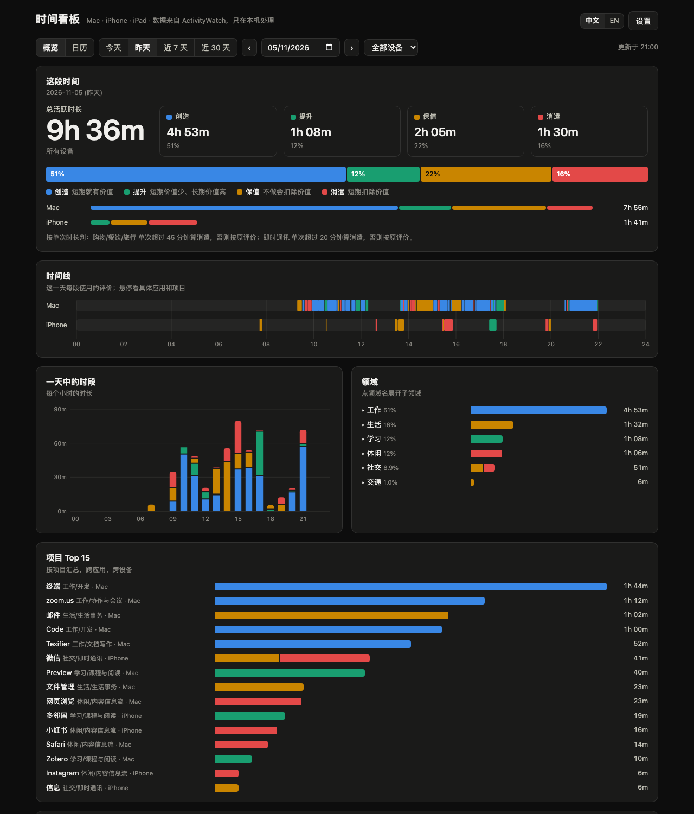

# timetrace

**Apple 全平台（Mac、iPhone、iPad）自动时间追踪：按目的和价值归类，配一个精美的本地看板，以及可以给 AI Agent 用的命令行和 MCP 服务。**

[English](README.md)



timetrace 是 [ActivityWatch](https://activitywatch.net) 的伴侣工具。ActivityWatch 记录 Mac 上当前在用哪个窗口；苹果的「屏幕使用时间」会把 iPhone、iPad 的使用记录同步到 Mac；timetrace 把两边合在一起，回答两个问题：

- **时间花在哪了？** 每一分钟都会归到「**领域 › 子领域 › 项目**」，比如「工作 › 开发 › 某个仓库」「生活 › 购物 › 淘宝」。统计的是你在做什么，而不只是开着哪个应用。同一个项目跨应用、跨设备汇总：同一个仓库的终端、编辑器、浏览器标签页都算在一起。
- **花得值不值？** 每一分钟还有一个**评价**，表示这段时间对你的价值：

| | 短期 | 长期 |
|---|---|---|
| **增加价值** | **创造**：短期就有价值（产出作品、做出决定） | **提升**：短期价值少、长期价值高（学习、健康、关系） |
| **扣除价值** | **消遣**：放松、娱乐、信息流 | **保值**：不做就会扣除价值的必要事务 |

购物、外卖、旅行、聊天这几类应用按「**单次**」时长来判：点开就走的算办事（保值），一次连续用很久的算消遣。多久算久，由你来定。

所有数据只在你的 Mac 上处理，不会上传。

## 安装

```bash
curl -fsSL https://raw.githubusercontent.com/vvyssen/timetrace/main/install.sh | bash
```

安装脚本会按需装好 [uv](https://docs.astral.sh/uv/) 和 ActivityWatch（通过 Homebrew），再装上 timetrace 和官方的 [iPhone/iPad 屏幕使用时间导入器](https://github.com/ActivityWatch/aw-import-screentime)，最后打开配置向导。重复运行就是原地升级。

有三项权限只能你自己打开。配置向导会逐项检查，并帮你打开对应的设置页面：

1. **给「Timetrace Importer」完全磁盘访问权限**：iPhone/iPad 的屏幕使用时间数据在受保护的目录里。权限只给这个小助手应用，不给 Python，也不给终端。
2. **跨设备共享**：iPhone/iPad 和 Mac 的「设置 › 屏幕使用时间」里都要打开。
3. **给 ActivityWatch 辅助功能权限**：这样才能记录 Mac 的窗口标题。

需要：macOS 12 及以上；iPhone/iPad 登录同一个 Apple 账户，并打开屏幕使用时间。

## 配置向导

第一次打开看板时，会带你走一遍：
1. **环境检查。**
2. **初步分析：** 看看最近 14 天的数据，内置规则已经能自动归类多少。
3. **打标记：** 给最常用的应用和项目打上标记。
4. **时长规则。**
5. **完成。**

之后随时点右上角「设置」都能回来。

内置规则库覆盖约 100 个常见的中文和国际应用。它没法知道的是你自己的项目，配置向导问的正是这部分：终端里的项目目录、编辑器里的项目、你常逛的网站，以及规则库里没有的应用。

### 跳过最麻烦的一步：让 Agent 帮你打标记

打标记是向导里唯一费时间的一步。可以点「**暂时跳过**」，交给 AI Agent 来做。Agent 会：
- 读出待标记的条目，用一张表给出建议；
- 拿不准的地方先问你；
- 等你确认后才写入。

```bash
timetrace agent install                  # 只需一次：连接 Claude Code / Codex / opencode
claude "$(timetrace agent prompt)"       # Codex 用户：codex "$(timetrace agent prompt)"
```

其他 Agent（opencode、Hermes 等）：运行 `timetrace agent prompt`，把输出的提示词粘贴给它。还有没标完的条目时，看板首页会显示一条小提醒。

<details><summary>提示词全文</summary>

```text
帮我把 timetrace 里还没分类好的时间打上标记。

1. 先运行 `timetrace taxonomy --json` 了解我的领域、子领域和四种评价（创造 / 提升 / 保值 / 消遣），再运行 `timetrace suggest --days 14 --format json` 看待标记的条目。如果你能用 timetrace 的 MCP 工具，就用 taxonomy 和 suggest 工具。
2. 按耗时从多到少，给每一条提出：领域 / 子领域 / 评价 / 项目名。依据是应用名、窗口示例和时长：终端、编辑器里的条目通常是我的项目目录；浏览器条目是网页或网站；手机应用看它是做什么的。
3. 拿不准的（尤其是一个项目算工作、学习还是个人兴趣），直接问我，不要猜，可以一次问几个。
4. 用一张表把建议列给我确认。我确认或修改后，再逐条写入：`timetrace tag --id <suggest 里的 id> --domain … --subdomain … --evaluation … --project …`（用 MCP 的话就用 tag 工具，并带上 id）。没得到我确认之前不要写入。
5. 写完再跑一次 suggest，告诉我还剩几项、大概多少时间没标。
```
</details>

## 看板

用 Spotlight 搜「**时间看板**」（英文系统搜 Timetrace），或者运行 `timetrace dash`。

- **概览**：按评价、设备、天、小时汇总，还有领域和项目排行。可以看今天、昨天、近 7 天、近 30 天，或任意一天。
- **时段分布**：「近 7 天 / 近 30 天」里有一张「小时 × 天」的热力图（近 30 天按星期几取平均）。可以按评价筛选，比如只看「消遣」都落在什么时候，旁边一句话写出最集中的时段和深夜占比。
- **日历**：周视图，每台设备一条轨道。每个色块是那段时间占时最多的项目，颜色表示它的评价。
- **设置**：外观（跟随系统 / 日间 / 夜间）、界面语言、时长规则、手机访问、AI Agent；也可以重新打开配置向导，或把分类规则重置为默认（重置前自动备份）。
- 中英双语，支持浅色和深色模式，配色经过色盲可辨识度校验，手机上也能正常看。

### 在手机上看

默认关闭。在看板右上角「手机查看」里打开，或运行 `timetrace lan on`。之后同一个 Wi‑Fi 下的手机打开形如 `http://你的Mac名.local:27181/?t=…` 的链接，就能只读查看看板。链接里带随机访问口令；打标记、改设置仍然只能在 Mac 上做；`timetrace lan rotate` 会让旧链接立即失效。

```bash
timetrace lan on                      # 在局域网上只读开放，并打印链接
timetrace lan url --date today        # 直达某一天的链接，适合放进每晚的日报消息
timetrace lan off
```

不授予任何权限也能先试：`timetrace demo` 会用虚构数据打开看板。

## 给 Agent 用

同一份数据也以命令行和 MCP 服务的形式提供给编程 Agent：

```bash
timetrace agent install     # 给 Claude Code、Codex、opencode 注册 MCP 服务和使用说明（skill）
```

```bash
timetrace summary --since 7d --group-by domain,evaluation
timetrace timeline --date yesterday --device iphone
timetrace suggest --format json          # 列出还需要打标记的条目
timetrace tag --keyword my-repo --domain 工作 --subdomain 开发 --evaluation 创造
timetrace doctor                         # 检查数据是否在正常流入
```

MCP 工具有：`summary`、`timeline`、`query`、`schema`、`taxonomy`、`suggest`、`tag`、`doctor`。其中 `tag` 会写入规则，使用说明里要求 Agent 先征得你的确认。可以直接问 Agent：「这周时间都花在哪了？」「帮我把还没分类的应用标一下。」

## 你的规则

唯一的规则来源是 `~/Library/Application Support/timetrace/config.yaml`，可以用 `timetrace config path` 查看路径。配置向导、`timetrace tag` 和 Agent 都写这一个文件。每次写入前自动备份，改完立即生效，不用重启。

- `mac_rules`：从上往下，先匹配到的生效；窗口标题规则排在整应用的兜底规则之前。`"."` 表示任意标题。
- `app_defaults`：iPhone/iPad 应用，按 bundle id 归类。
- `duration_rules`：怎样算「一次」使用，以及多久算「久」。
- `timetrace config import categories.yaml`：直接采用一个现有的规则文件。`timetrace config reset --lang zh`：从内置规则库重新生成。
- 可选：`timetrace sync-aw --apply` 把领域树同步到 ActivityWatch 自己的分类里，会先备份它原来的设置。

## 原理

- **Timetrace Importer.app** 是一个约 70 KB 的启动器。它持有完全磁盘访问权限，负责运行 `aw-import-screentime watch`。还没授权时，它会一直等待，并把状态报告给看板。
- 终端窗口标题只显示「OpenCode」时，会按当时活跃的 opencode 会话判断是哪个项目，所以 Agent 会话也能归到正确的项目下。
- 看板只监听 127.0.0.1，会校验 Host，每次写操作都需要启动时生成的令牌。
- 后台服务是两个 launchd 任务：`com.github.vvyssen.timetrace.dashboard` 和 `…importer`，日志在 `~/Library/Logs/timetrace/`。

## 局限

- **iPhone/iPad 只有应用级数据。** 屏幕使用时间不记录页面标题和聊天对象，所以微信不论是工作还是家人聊天，都只能算「即时通讯」。
- **暂不支持 Apple Watch、Apple TV、Vision Pro**：还没验证过它们的使用记录会不会同步到 Mac。
- **iPhone/iPad 数据的导入可能被系统更新打断。** 导入依靠 `aw-import-screentime` 读取苹果未公开的屏幕使用时间格式，macOS 更新后可能暂时失效，要等导入器跟进。`timetrace doctor` 和看板都会显示最近一次导入的时间。
- **浏览器时间只到窗口标题这一级。** 想要网址级的细节，可以装 ActivityWatch 的[浏览器扩展](https://github.com/ActivityWatch/aw-watcher-web)。

## 卸载

```bash
timetrace uninstall            # 删除后台服务和两个应用，保留你的数据和规则
uv tool uninstall timetrace && uv tool uninstall aw-import-screentime
```

另外：
- 在系统设置的完全磁盘访问权限里，把 Timetrace Importer 移除。
- 规则也不想要了的话，删除 `~/Library/Application Support/timetrace` 目录。

## 致谢

本项目基于 [ActivityWatch](https://github.com/ActivityWatch/activitywatch) 和 [aw-import-screentime](https://github.com/ActivityWatch/aw-import-screentime)（后者使用了 [ccl-segb](https://github.com/cclgroupltd/ccl-segb)）。timetrace 是独立项目，与 ActivityWatch、Apple 均无关联。

MIT 许可证。
